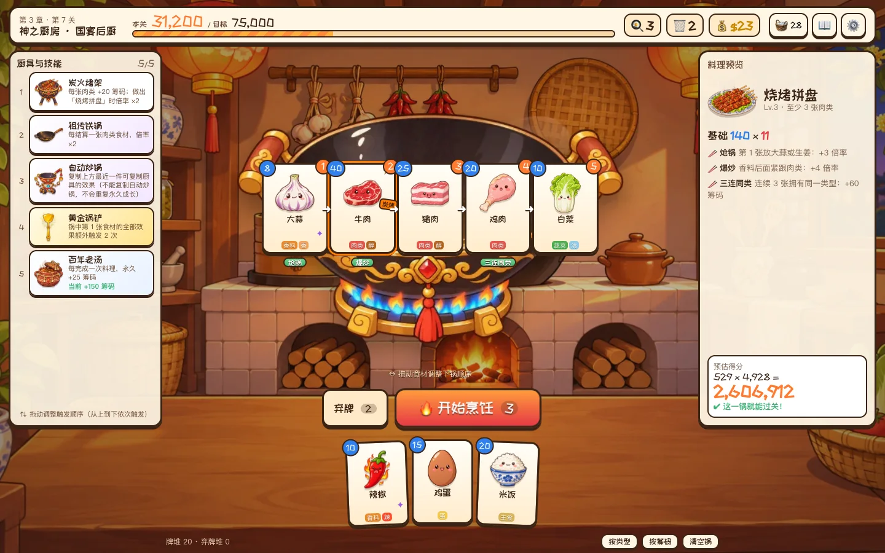

<p align="center">
  
</p>

<h1 align="center">料理之神 Cooking God</h1>

<p align="center">
  <b>挑食材、排好下锅顺序、让厨具连锁乘算——把一盘家常小炒炒到几百万分的 Roguelike 卡牌构筑网页游戏。</b>
</p>

<p align="center">
  <a href="https://cooking-god.vercel.app"><b>▶ 在线试玩：cooking-god.vercel.app</b></a>
  <br />
  <sub>无需安装，电脑和手机浏览器都能玩，进度自动保存在本地</sub>
</p>


## 截图

| 选食材、排顺序，右侧实时预览配方、技法和预估得分 | 结算逐步演出：每一次加筹码、加倍率、×2 都看得见 |
|---|---|
|  |  |
| **商店：厨具、配方秘籍、稀有食材** | **Boss 规则在开打前讲清楚** |
|  |  |

<p align="center">
  
  
</p>

一局 9 关，每关 4 次烹饪：**抽食材 → 排顺序 → 做料理 → 厨具连锁 → 倍率爆炸**。纯前端，美术全部为项目原创生成的卡通插画。

## 快速开始

```bash
pnpm install
pnpm dev          # 本地开发服务器 http://localhost:5173（线上版：https://cooking-god.vercel.app）
pnpm test         # 单元测试（计分、Boss、商店、存档、胜负路线、防死循环）
pnpm build        # 类型检查 + 生产构建，产物在 dist/（相对路径，可直接丢到任意静态服务器）
pnpm preview      # 预览生产构建
```

平衡性模拟（自动玩家跑 N 局，输出胜率和关卡分布，不在默认测试里）：

```bash
SIM_N=30 pnpm vitest run scripts/sim.test.ts --silent=false --reporter=verbose
```

重新生成 README 截图（需要本机的 Google Chrome 和 cwebp，先 `pnpm dev`）：

```bash
node scripts/screenshots.mjs http://localhost:5173/
```

## 小红书小工具版

同一套源码还能打包成小红书小工具（离线 H5 zip）：

```bash
pnpm build:minitool   # 类型检查 + 小工具构建 + 规范检查 + 打包
                      # 产物：minitool-release/cooking-god-minitool-<版本>.zip
node scripts/minitool/shots.mjs 390x844          # 手机尺寸冒烟截图（模拟容器 API），输出到 minitool-release/shots
LEGACY=1 node scripts/minitool/shots.mjs 390x844 # 去掉 Chrome 61 没有的 API 再跑一遍
```

和网页版的区别（`vite.minitool.config.ts`、`src/platform/`、`scripts/minitool/`）：

- **产物形态**：经典脚本（IIFE + `defer`），ES2017 / Chrome 61 目标；入口 JS/CSS 放在 `static/`；`index.html` 带静态首屏。
- **旧内核兼容**：`src/platform/polyfills.ts` 补上依赖实际用到的新 API；`scripts/minitool/css-compat.mjs` 在构建后给 flex `gap`、`min()/max()/clamp()`、`dvh`、`env()` 等补回退写法。
- **存档**：小工具里用容器 Storage（客户端 9.46+），不回退浏览器存储；客户端太旧或读写失败时在界面上提示。
- **容器能力**：按 `getWindowInfo` 避让右上角胶囊，对局中屏幕常亮，烹饪/过关有振动反馈（设置里可关），结算页可以分享小工具卡片；都会先判断客户端版本和方法是否存在。
- **字体**：只打包游戏里用到的字。改了界面文案后先运行 `python3 scripts/minitool/subset-font.py <ZCOOLKuaiLe-Regular.ttf>`（需要 `pip install fonttools brotli`），再重新打包。

上传前请在创服平台模拟器里完整玩一遍，再分别用 Android 和 iOS 真机扫码验证同一个包。

## 玩法

- 3 章 × 3 关 = 9 关，第 3、6、9 关是 Boss。通关后可以继续**无尽模式**（目标每关 ×4）。
- 每关 4 次烹饪、3 次弃牌。手牌 8 张，每次最多放 5 张进锅。
- **得分 = 筹码 × 倍率**。累计得分达到目标即过关，否则游戏结束。
- 过关后进商店：买厨具/技能、配方升级、食材强化/升星/复制、买新食材、移除食材、刷新。

### 结算顺序（事件日志按此顺序生成，动画逐条播放）

1. 计算有效标签：食材自带标签 → 神秘蘑菇复制前一张 → 厨具改规则（分子料理机）→ Boss 禁用判定
2. `onCookStart`
3. 匹配料理（取满足条件中 tier 最高的；同 tier 取基础分高的；兜底「家常乱炖」）→ 基础筹码 × 倍率
4. `onRecipeMatched`（成长类厨具在这里结算存量）
5. 逐张食材（按锅中顺序），每张重复 `1 + 重复触发次数` 遍：
   食材筹码 → 食材效果 → 强化 → **烹饪技法**（顺序效果）→ 各厨具 `onIngredientPlayed`
6. `onCookEnd`（×倍率类、成长类）
7. Boss 规则（例如美食家的 ×0.25）
8. 最终得分 = floor(筹码 × 倍率)

同一时机内，厨具按玩家排列顺序（从上到下）依次触发，可以拖动调整。

### 内容

| 类别 | 数量 | 位置 |
|---|---|---|
| 食材 | 30（肉、海鲜、蔬菜、菌菇、香料、主食、蛋、锅底、特殊） | `src/game/data/ingredients.ts` |
| 料理 | 10 + 兜底「家常乱炖」 | `src/game/data/recipes.ts` |
| 烹饪技法（顺序效果） | 6：炝锅、爆炒、腌制、鲜上加鲜、三连同类、收汁 | `src/game/data/techniques.ts` |
| 厨具 / 技能 | 23 | `src/game/data/tools.ts` |
| Boss | 3：清淡主义评委、挑剔的美食家、终极食神 | `src/game/data/bosses.ts` |
| 关卡目标、经济参数 | — | `src/game/data/levels.ts` |

改变规则的厨具（不只是数值 Buff）：分子料理机（蔬菜和肉类互通）、自动炒锅（复制上方厨具）、黄金锅铲 / 压轴汤勺（重复触发）、颠勺秘诀（技法触发两次）、隔热手套（手牌 +1、弃牌 +1）、多层料理台（一次 6 张）、竹蒸笼（少即是多）。

### 三条主要构筑路线

- **肉类乘算**：祖传铁锅（每张肉 ×2）+ 炭火烤架 + 分子料理机（蔬菜也算肉）+ 自动炒锅复制铁锅，做烧烤拼盘。
- **辣味连锁**：地狱辣油（每张辣 ×3）+ 麻辣连锁 + 黄金锅铲（第一张重复 2 次），把辣椒放第一位；买红油锅底、辣椒扩充卡组。
- **永久成长**：百年老汤（每次 +25 筹码）+ 腌菜坛（每张蔬菜永久 +×0.1）+ 老冰箱（弃牌成长）+ 回锅秘术（同关越做越强）。

另有：黑暗料理秘籍 + 复制食材（重复流）、鲜味结晶 + 海鲜/菌菇（鲜味流）、厨房沙漏 + 颠勺秘诀（顺序技法流）、招财猫（存钱流）。

## 设计决策（未在需求里规定、由我定的部分）

- **目标分数**：600 / 1,500 / 3,000(B) / 6,000 / 13,000 / 30,000(B) / 75,000 / 180,000 / 1,200,000(B，终极食神 ×3)。用 `scripts/sim.test.ts` 的贪心自动玩家调过：它在 30 局里约 1/3 通关，绝大多数能打到最终 Boss。人类玩家会排顺序、会有意识地构筑，通关率应当更高；最终 Boss 需要成型的乘算构筑。
- **经济**：起始 $4；过关 $3（Boss 关 $5）+ 每剩 1 次烹饪 $1 + 利息（每 $5 给 $1，最多 $5）。厨具价格 $4–10，出售得半价。刷新 $2 起、每次 +1。移除食材 $3 起、同一商店每次 +1，卡组最少 12 张。
- **厨具栏上限 5 件**，满了要先卖。商店不会刷出已拥有的厨具。
- **抽牌**：牌堆抽空时把弃牌堆洗回去，避免卡死。
- **初始卡组 28 张**，偏向常见食材；稀有食材（松露、鱼子酱、神秘蘑菇、锅底、螃蟹…）主要从商店获得。
- **品质**用星级表示（每升 1 星 +10 筹码），**稀有度**只影响商店出现概率。
- **强化**：鲜活 +30 筹码、秘制 +4 倍率、炭烤 ×1.5、镀金 每次结算 +$1。
- **Boss 禁用的牌**：不提供筹码、不计入配方、不触发技法和厨具，但仍占锅位。
- **自动炒锅**复制上方最近一件可复制的厨具；复制品不能触发永久成长（防止成长翻倍），自动炒锅本身不可被复制（复制链最多一层）。被动规则类（手套、料理台）不受复制影响。
- **防死循环**：重复触发在结算前一次性算好，每张牌最多重复 6 次；技法重复同样封顶；单次烹饪最多 4,000 条事件，超出直接截断（模糊测试里从未触发）。没有任何效果会在结算中途再次调用其他厨具的钩子。
- **预览显示精确的预估得分**：MVP 优先让玩家看懂为什么得分，而不是藏信息。
- **大数**：自写的 `m × 10^e` 表示（`src/game/scoring/bignum.ts`），纯 JSON 可序列化，1e11 以下显示千分位，更大的用科学计数法（如 `3.21e15`）。

## 美术与音效

- 美术为卡通动画风格，全部是本项目生成的原创图片：食材 30、厨具 23、料理 11、Boss 3、商店道具、炒锅、厨房背景、吉祥物，共 75 张，压缩成 webp 后约 2 MB，放在 `public/art/`。
- 生成脚本：`scripts/art/generate.py`，提示词清单在 `scripts/art/manifest.json`。它调用 `~/.claude/skills/image-gen/scripts/gen_image.py`，provider 为 magpie，模型 `gpt-image-2.6-sunburst`，透明背景，再用 `cwebp` 压缩。原始 PNG 存在 `scripts/art/raw/`（已加入 gitignore）。
  ```bash
  python3 scripts/art/generate.py               # 补齐缺失的图
  python3 scripts/art/generate.py tools/knife   # 重画指定的图
  ```
- 动画：卡牌用 `motion` 的 layout/Reorder（手牌→锅的飞入、拖拽排序），Canvas 粒子，CSS 震屏。结算节奏逐条加速，支持 1×/2×/4× 和一键跳过。会尊重系统的「减弱动态效果」设置。
- 音效：Web Audio 实时合成（`src/audio/sfx.ts`），连锁越长音越高，没有音频文件。
- 字体：站酷快乐体（`@fontsource/zcool-kuaile`，按字符子集打包进项目，不走 CDN）。

## 代码结构

```
src/
  game/
    types.ts            所有数据结构
    data/               食材、配方、技法、厨具、Boss、关卡与经济参数（纯数据 + 钩子）
    effects/dispatch.ts 厨具触发顺序、自动炒锅复制解析、被动规则
    scoring/            大数、配方匹配、计分结算（输出结构化事件日志）
    engine/             局内状态机（开局/抽牌/烹饪/弃牌/过关/商店）、种子随机数
    state/store.ts      Zustand 状态 + localStorage 自动存档
    sim/bot.ts          自动玩家（平衡模拟 + 胜利路线测试）
    __tests__/          单元测试
  components/           React UI
  animations/fx.ts      粒子、震屏、事件节奏
  audio/sfx.ts          合成音效
```

引擎全部是纯函数：`(state, ...args) => newState`，非法操作抛 `GameError`。随机数状态存在 `RunState.rng` 里，同种子 + 同操作序列 = 完全相同的对局（标题页可以指定种子）。

## 如何扩展

### 新增食材

在 `src/game/data/ingredients.ts` 的 `INGREDIENT_LIST` 里加一条：

```ts
{ id: 'tofu', name: '豆腐', types: ['veg'], flavors: ['fresh'], chips: 14, rarity: 'common', price: 2,
  effect: { kind: 'mult', amount: 2 }, flavorText: '嫩。' },
```

`effect` 可选 `mult` / `xmult` / `chips` / `mimic`。新效果类型在 `types.ts` 的 `IngredientEffect` 里加，并在 `scoring/score.ts` 的食材结算段处理。然后在 `scripts/art/manifest.json` 加 `{"out": "ingredients/tofu", "style": "ingredient", "desc": "...", "mood": "..."}`，运行生成脚本。

### 新增配方

在 `src/game/data/recipes.ts` 的 `RECIPE_LIST` 里加一条，条件用数据描述：

```ts
requirements: [
  { kind: 'tag', tag: 'seafood', count: 1 },        // 至少 1 张海鲜（按有效标签）
  { kind: 'ingredient', ids: ['noodles'], count: 1 }, // 指定食材
  { kind: 'distinctTypes', count: 4 },              // 覆盖 4 种类型
  { kind: 'minCards', count: 4 },                   // 至少 4 张
],
```

`tier` 决定优先级。配上 `dishes/<id>` 的图即可。

### 新增厨具

在 `src/game/data/tools.ts` 的 `TOOL_LIST` 里加一条，实现需要的钩子：

```ts
{
  id: 'pressureCooker', name: '高压锅', kind: 'tool', rarity: 'uncommon', price: 6, routes: ['combo'],
  desc: '锅底食材 ×2 倍率',
  hooks: {
    onIngredientPlayed(ctx, self, card) {
      if (ctx.hasTag(card, 'broth')) ctx.xMult(2, `${card.def.name} 高压 ×2`);
    },
  },
},
```

可用的钩子：`modifyTags`、`retriggers`、`techniqueRepeats`、`onCookStart`、`onRecipeMatched`、`onIngredientPlayed`、`onCookEnd`、`onDiscard`；被动规则用 `passive`；永久成长用 `initData` + `ctx.grow()` + `status()`。`ctx` 提供 `addChips / addMult / xMult / addGold / grow / scratch` 等，每次调用都会自动写入事件日志并驱动动画，不需要改 UI。

## 已知限制

- 平衡只用贪心自动玩家粗调过，个别厨具（如竹蒸笼、招财猫）的强度还需要真人试玩反馈。
- 没有跨局的元进度（解锁新内容、成就等），每局从同样的起点开始。
- 手机端可以玩，但桌面端体验更完整：手机上手牌需要横向滑动，悬停说明改为长按。
- 结算预览显示精确得分；如果想要更多未知感，可以改为只显示配方和技法。
- 存档只在当前浏览器本地，不跨设备同步。
